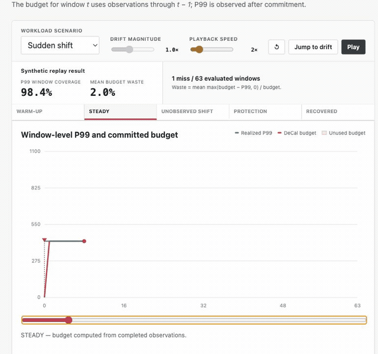

# DeCal: Decoupled Tail Budget Control for Non-Stationary LLM Serving

DeCal is a drift-aware budget control framework for LLM serving workloads. It learns per-client, per-window tail budgets from historical request distributions, detects workload drift online, and adapts capacity with decoupled empirical calibration.

This repository contains the main experiment pipeline for evaluating DeCal on ServeGen language traces and BurstGPT-style production traces. It is organized as a compact research artifact: core algorithms, data loaders, evaluators, main experiment runners, and reproducible dependency files.



## Highlights

- Online drift detection over lightweight workload summaries.
- Drift-adaptive tail budget allocation for non-stationary request streams.
- Cross-client transfer for cold-start and recovery scenarios.


## Repository Layout

```text
.
├── data/                         # Workload traces
│   ├── ServeGen/
│   └── BurstGPT/
├── demo/                         # Interactive causal replay
├── src/decal/
│   ├── allocators/               # Budget allocation methods
│   ├── detectors/                # Online drift detectors
│   ├── evaluation/               # Metrics and evaluators
│   ├── experiments/              # Main experiment runner and CSV export
│   ├── transfer/                 # Cross-client transfer utilities
│   ├── data_loader.py
│   └── orchestrator.py
├── environment.yml               # Conda environment
├── pyproject.toml                # Python build-system metadata
├── requirements.txt              # Pinned pip dependencies
├── run_all.py                    # Project-root main experiment entry point
├── run.sh                        # Thin shell wrapper around run_all.py
└── setup.py                      # Editable package installation
```

## Installation

Use Python 3.9 or newer. Conda is recommended for reproducible experiments.

Create the Conda environment:

```bash
conda env create -f environment.yml
conda activate decal
pip install -e .
```

If you prefer `venv`, use the pinned pip requirements:

```bash
python3 -m venv .venv
source .venv/bin/activate
pip install -r requirements.txt
pip install -e .
```

`environment.yml` and `requirements.txt` pin the dependencies used by this release. The editable install registers the `decal` package and the `decal-run` console entry point.


## Quick Start

Run the main DeCal experiment:

```bash
python3 run_all.py
```

Run ServeGen language workloads only:

```bash
python3 run_all.py --dataset servegen
```

Run BurstGPT only:

```bash
python3 run_all.py --dataset burstgpt
```

Run selected ServeGen language workloads:

```bash
python3 run_all.py --dataset servegen --models m-small m-mid
```

The shell wrapper is equivalent:

```bash
./run.sh --dataset servegen --models m-mid
```

## Main Experiment

The default command evaluates the DeCal method on the selected main workload traces.
It reports the core allocation metrics:

- window-level P99 failure rate
- per-request OOM probability
- waste rate
- P99 coverage
- prediction error metrics
- drift-trigger metrics produced by DeCal

The runner executes only the DeCal main experiment.

To compare against the aggregate ServeGen and BurstGPT numbers reported in the
manuscript, run the default main suite rather than a single workload:

```bash
python3 run_all.py
```

For ServeGen, the manuscript-facing default is the language suite
(`m-large`, `m-mid`, and `m-small`). Commands such as `--models m-mid`
intentionally report only that workload, so their Throughput and SLO Goodput
values should not be compared directly with the aggregate ServeGen row.

The reported Throughput, P95/P99 Latency, Quality Proxy, and SLO Goodput columns
use the paper's replay-derived display units. Raw replay indicators are kept in
the JSON output with a `_raw` suffix for auditability.

The auxiliary ServeGen categories remain available for inspection, but they are
not part of the default main table:

```bash
python3 run_all.py --dataset servegen --categories reason multimodal
```


## Command Reference

```bash
python3 run_all.py \
  --dataset {all,servegen,burstgpt} \
  --data_root data \
  --output_dir results \
  --models m-small m-mid \
  --categories language \
  --field auto \
  --no_export_csv
```

Useful defaults:

- `--dataset all`
- ServeGen `--categories language`
- `--data_root data`
- `--output_dir results`
- `--field auto`
- CSV export enabled


## Troubleshooting

If Python cannot import `decal`, run:

```bash
pip install -e .
```

If a ServeGen model is skipped, check `results/servegen/dataset_validation.json` for the missing field or file. For multimodal workloads, the runner may choose a model-specific default field when `--field auto` is used.

If a full run is slow, start with a single small workload:

```bash
python3 run_all.py --dataset servegen --models m-small --no_export_csv
```
